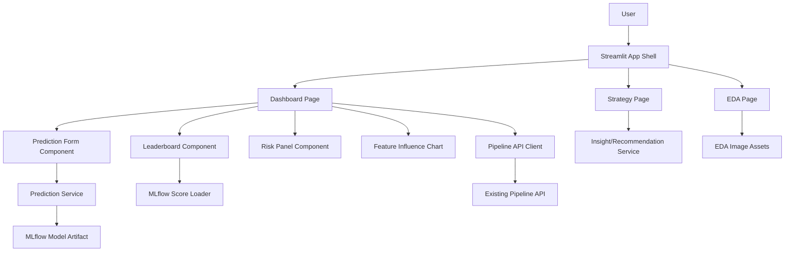

# Design: Streamlit CRM Dashboard Enhancement

## Overview

The enhanced app will be a new Streamlit project in `ccrm-streamlit-pro`. It will preserve the original dashboard's three major experiences while improving structure, copy quality, interaction design, error handling, and performance.

The chosen approach is a source-port enhancement: copy the necessary frontend assets and compatible service logic into the new repository, then refactor the Streamlit app into clearer modules. This keeps MLflow and FastAPI integration close to the current implementation and avoids a React/backend contract split during this phase.

## Existing System Context

The source app currently has:

- `streamlit/app.py`: app entrypoint, page config, custom navigation, footer.
- `streamlit/pages/dashboard.py`: main dashboard, prediction form, leaderboard table, result display, feature influence chart.
- `streamlit/pages/strategy.py`: strategy report based on current or last model.
- `streamlit/pages/eda.py`: static EDA image report.
- `streamlit/common/config.py`: environment variables, model display names, MLflow constants.
- `streamlit/common/mlflow/*`: MLflow score and model loading.
- `streamlit/utils/prediction.py`: model caching, preprocessing, probability extraction.
- `streamlit/utils/data_loader.py`: leaderboard, sample impact data, strategy guide data.

The current app is functional but tightly coupled. Dashboard UI, form state, prediction execution, risk rendering, and chart rendering live in one large file. The new app will preserve behavior but reduce coupling.

## Proposed Repository Structure

```text
ccrm-streamlit-pro/
  .kiro/specs/streamlit-enhancement/
    requirements.md
    design.md
    tasks.md
  streamlit_app/
    app.py
    assets/
      eda/
    components/
      app_shell.py
      leaderboard.py
      prediction_form.py
      risk_panel.py
      strategy_cards.py
      eda_topic_view.py
    constants/
      domain.py
      models.py
      ui.py
    pages/
      dashboard.py
      strategy.py
      eda.py
    services/
      mlflow_service.py
      prediction_service.py
      pipeline_client.py
      insight_service.py
    styles/
      theme.py
  config/
    .env.example
  docker-compose.yaml
  README.md
```

## Architecture



## Core Design Decisions

### App Shell and Navigation

Use a single Streamlit entrypoint with a page registry. The navigation should be predictable and avoid ad-hoc button columns as the only navigation mechanism. The shell should own page selection and footer rendering. Each page should expose a `render()` function.

### Form Handling

Use `st.form` for prediction inputs so changing one value does not trigger the full prediction flow on every rerun. The form component returns a typed dictionary or dataclass-like payload. The dashboard page coordinates form submission and result rendering.

### Domain Mappings

Move label-to-id mappings into `constants/domain.py`. Mappings should follow source ETL constants:

- Gender: `F=0`, `M=1`.
- Education: Uneducated 1, High School 2, College 3, Graduate 4, Post-Graduate 5, Doctorate 6, Unknown 7.
- Marital: Single 1, Married 2, Divorced 3, Unknown 4.
- Income: Less than $40K 1, $40K - $60K 2, $60K - $80K 3, $80K - $120K 4, $120K + 5, Unknown 6.
- Card type: Blue 1, Silver 2, Gold 3, Platinum 4.

The implementation should decide whether UI labels are Korean or English, but the stored feature values must match model expectations.

### Prediction Service

`prediction_service.py` should own:

- Required columns by model.
- Input dataframe creation.
- Categorical dtype conversion.
- Model resource lookup.
- Probability extraction.
- Risk tier calculation.

The probability index must be verified during implementation. The source function returns `probability[0][0]` while comments describe class 1 churn probability. The enhanced app should not silently change this without evidence. The task list includes a verification step.

### MLflow Service

`mlflow_service.py` should own:

- Tracking URI validation.
- Experiment lookup.
- Latest run score loading.
- Model artifact loading.
- Flavor-specific loaders.
- Streamlit cache wrappers.

Failure modes should produce structured errors that pages can render.

### Dashboard Page

The dashboard should prioritize the repeated user workflow:

1. Review model status and leaderboard.
2. Enter customer values in grouped sections.
3. Run prediction.
4. Read risk score, tier, and recommended CRM action.
5. Review feature influence context.

The result panel should avoid color-only communication. Risk tiers should include labels such as Low, Medium, and High.

### EDA Page

The EDA page should transform the current long static report into topic navigation. Each topic should contain:

- Title.
- Image.
- Short explanation.
- Interpretation.
- Optional action implication.

The six source images are retained.

### Strategy Page

The strategy page should use the current model and last risk tier if available. It should separate:

- Model-level strengths and caveats.
- Customer-level suggested action.
- Operational next step.

If no prediction has run, it should show general strategy guidance.

## Data Flow

### Prediction Flow

1. User submits form.
2. Form component emits customer input payload.
3. Dashboard computes derived `utilization_ratio`.
4. Prediction service builds a single-row dataframe.
5. Prediction service loads cached model through MLflow service.
6. Prediction service preprocesses columns and dtypes.
7. Model returns probability.
8. Dashboard stores result in Streamlit session state.
9. Risk panel renders probability, tier, and action.

### Leaderboard Flow

1. Dashboard requests model metrics.
2. MLflow service loads latest finished display runs.
3. Service maps raw run names to display names.
4. Leaderboard component renders table and metric comparison chart.
5. If unavailable, Dashboard renders warning with recovery guidance.

### EDA Flow

1. EDA page loads static topic metadata.
2. User selects a topic tab.
3. Component renders image and interpretation.
4. Missing images render a non-blocking warning.

## Error Handling

- Missing `PIPELINE_API_BASE_URL`: show setup instructions and disable dataset-dependent views.
- Missing `MLFLOW_TRACKING_URI`: show setup instructions and disable model-dependent views.
- MLflow experiment not found: show experiment name and suggest running the source stack.
- Model artifact load failure: show selected model and high-level failure message; keep details expandable.
- Prediction failure: preserve form values and show retry guidance.
- Missing EDA image: show topic metadata and missing file path.

## Compatibility

The first version should support the source Docker topology conceptually:

- Pipeline service exposes FastAPI on port 8000 inside Docker and 18000 on host.
- MLflow service exposes port 5000 inside Docker and 15000 on host.
- Streamlit service exposes port 8501 inside Docker.

The enhanced repository can start with local Streamlit execution and then add Docker support. It should keep `.env.example` aligned with the source service names and host ports.

## Styling

Use Streamlit-native layout first, with small scoped CSS only where Streamlit lacks adequate styling. The design should feel like an operational CRM/analytics tool:

- Dense but readable.
- Clear metric hierarchy.
- Restrained palette with status colors.
- No oversized marketing hero.
- No decorative-only background effects that reduce readability.

## Test Strategy

The verification strategy maps to requirements:

- Syntax verification: `python -m compileall streamlit_app`.
- Unit-level checks for mapping constants and risk tier calculation.
- Service-level checks using mock MLflow/Pipeline responses where feasible.
- Manual Streamlit smoke test for Dashboard, Strategy, and EDA.
- Docker smoke test if compose support is included.

## Migration Strategy

1. Create spec documents and get user approval.
2. Copy only necessary app assets and service logic from the original repository.
3. Refactor into the new structure.
4. Add caching and error boundaries.
5. Improve Dashboard, EDA, and Strategy pages.
6. Verify locally.
7. Keep original repository untouched.
